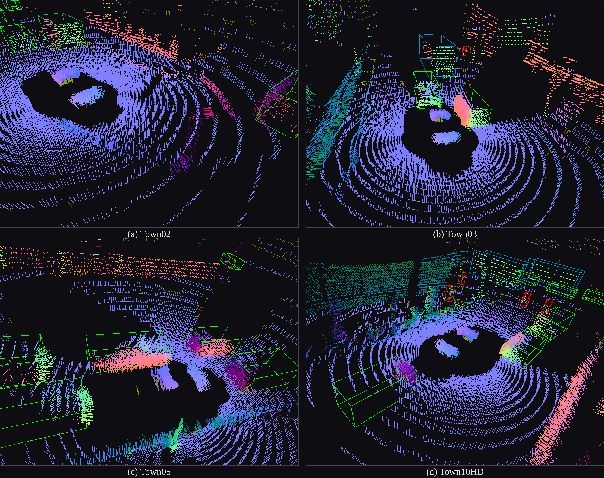
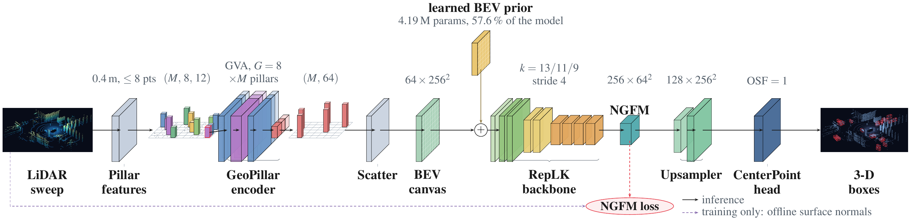
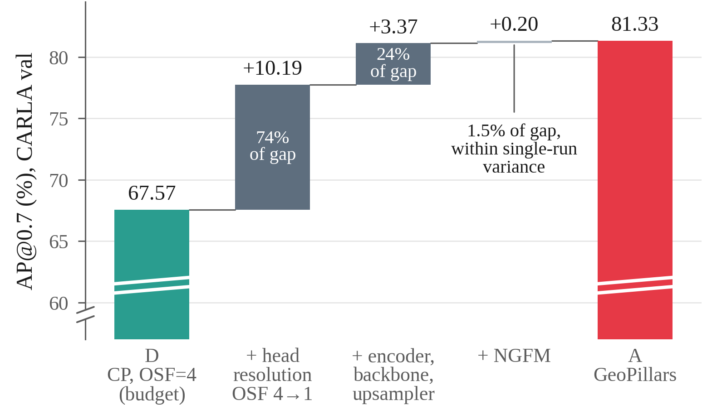

<div align="center">

# GeoPillars: A Large-Kernel Pillar Detector for Single-Sweep LiDAR Under Point Sparsity

**Chaitanya Dumbre, Shubham Sarkar, Akash Mohapatra, Ghanasham Patil, and Sheetal Girase**

School of Computer Science and Engineering, MIT World Peace University, Pune, India

[](#citation)
[](https://huggingface.co/GeoPillars/GeoPillars)
[](https://github.com/open-mmlab/mmdetection3d)
[](LICENSE)



<sub>Surface normals estimated offline and used as the auxiliary training target, on one scan from each CARLA town. Ground-truth boxes are green for cars, cyan for buses and red for pedestrians.</sub>

</div>

## Abstract

GeoPillars is a pillar-based 3D detector for single-sweep LiDAR under a hard input budget of eight points per 0.4 m pillar, a budget that discards 46.6% of in-range returns. It combines a pillar encoder with extra geometric features, a learned absolute bird's-eye-view positional prior, a large-kernel backbone, auxiliary surface-normal supervision and a full-resolution detection head. Trained on 123k synthetic CARLA scans and scored on cars only, it reaches 81.33 bird's-eye-view AP@0.7, which is 13.76 points above CenterPoint at a matched input budget and 1.91 above CenterPoint at its native, denser budget. The validation split is per-frame rather than scene-disjoint, so both figures measure in-distribution interpolation. When the 13.76-point gap is taken apart one rung at a time, detection-head resolution alone recovers 10.19 points, a bundled swap of encoder, backbone, neck and positional prior adds 3.37, and the auxiliary normal branch the design was built around adds 0.20, inside the run-to-run floor this study can resolve. With heading reversals folded out, orientation error is similar for all seven models, 0.042 to 0.052 rad, and the lowest belongs to a baseline. The architecture does reverse headings less often, in 0.80% of matches against 1.55% for the resolution-matched baseline, in a dataset where 44.5% of validation car yaws lie within 10<sup>-6</sup> rad of an axis. GeoPillars is the slowest model we measured at batch 1 and the second most memory-intensive at batch 24, which works against the sparsity constraint that motivated it. Evaluated zero-shot on 6,743 real nuScenes keyframes, no model transfers. Retention ranges from 3.7% to 12.2%, and the native-budget CenterPoint retains the most. A collection defect left intensity constant in every scan, so all seven models learned from geometry alone and the comparisons among them remain internally valid. The collection pipeline, configurations, checkpoints and checksummed evaluation records will be released with the paper.

## Method

<p align="center">
  
</p>

Each 0.4 m pillar keeps at most eight returns, and the pillar builder appends eight geometric channels to every point: cluster offset, pillar-centre offset, range, azimuth and occupancy density. The GeoPillar encoder mixes the points of a pillar with grouped vector attention (G = 8), max-pools each pillar to a 64-dimensional vector and scatters it onto a 256 × 256 bird's-eye-view canvas, where a learned absolute positional prior is added. A three-stage large-kernel backbone (k = 13/11/9, each stage with a parallel 5 × 5 branch, total stride 4) reduces the canvas to 64 × 64. There Normal-Guided Feature Modulation (NGFM) predicts a unit surface normal per cell and gates the features with it. Two transposed-convolution stages restore the full grid, and a stock CenterPoint head decodes at output stride 1, so every detection cell is one pillar. The dashed path runs only during training: surface normals estimated offline from the same sweep are pooled to 64 × 64 and supervise NGFM through a masked cosine loss.

## Results

All numbers are for the car class at epoch 8 on the CARLA validation split (30,842 scans), with AP 40-point interpolated over exact rotated bird's-eye-view IoU. They come from [`results/eval_results_carla_test_v2.json`](results/eval_results_carla_test_v2.json) unless stated otherwise.

### Model zoo

| Run | Model | Head OS | Params | AP@0.7 | AP@0.5 | Config | Weights |
|:-:|---|:-:|--:|:-:|:-:|---|---|
| A | GeoPillars | 1 | 7.28 M | **81.33** | **93.15** | [config](config/geo_pillars_h100_intensity.py) | [HF](https://huggingface.co/GeoPillars/GeoPillars/tree/main/geo_pillars_h100_intensity) |
| B | GeoPillars, xyz input | 1 | 7.28 M | 81.21 | 93.06 | [config](config/geo_pillars_h100_nointensity_final.py) | [HF](https://huggingface.co/GeoPillars/GeoPillars/tree/main/geo_pillars_h100_nointensity_final) |
| C | CenterPoint, native budget (0.2 m, 20 points) | 4 | 4.84 M | 79.42 | 91.92 | [config](config/centerpoint_h100_intensity_original.py) | [HF](https://huggingface.co/GeoPillars/GeoPillars/tree/main/centerpoint_h100_intensity_original) |
| D | CenterPoint, GeoPillars budget (0.4 m, 8 points) | 4 | 4.84 M | 67.57 | 89.55 | [config](config/centerpoint_h100_intensity.py) | [HF](https://huggingface.co/GeoPillars/GeoPillars/tree/main/centerpoint_h100_intensity) |
| E | CenterPoint, GeoPillars budget, xyz input | 4 | 4.84 M | 67.01 | 89.40 | [config](config/centerpoint_h100_no_intensity.py) | [HF](https://huggingface.co/GeoPillars/GeoPillars/tree/main/centerpoint_h100_no_intensity) |
| F | CenterPoint, GeoPillars budget, head at OS 1 | 1 | 7.05 M | 77.76 | 92.47 | [config](config/centerpoint_osf1_ablation.py) | [HF](https://huggingface.co/GeoPillars/GeoPillars/tree/main/centerpoint_osf1_ablation) |
| G | GeoPillars without NGFM | 1 | 6.98 M | 81.13 | 93.12 | [config](config/centerpoint_geopillar_encoder_replk_distributed.py) | [HF](https://huggingface.co/GeoPillars/GeoPillars/tree/main/centerpoint_geopillar_encoder_replk_distributed) |

OS is the output stride of the detection head relative to the pillar grid. Every run except C uses 0.4 m pillars with at most 8 points. The parameter counts of A, B and G include the 4.19 M-parameter positional prior.

### Decomposing the gap

The 13.76-point gap between the budget-matched CenterPoint (D) and GeoPillars (A), taken apart one rung at a time. All four runs are re-evaluated on the same split, so the increments sum to the gap exactly.

| Run | Change from the row above | AP@0.7 | Δ |
|:-:|---|:-:|:-:|
| D | CenterPoint at the GeoPillars budget | 67.57 | |
| F | detection head at output stride 1 | 77.76 | +10.19 |
| G | GeoPillar encoder, RepLK backbone, upsampler neck and positional prior | 81.13 | +3.37 |
| A | NGFM branch | 81.33 | +0.20 |

<p align="center">
  
</p>

Head resolution alone accounts for 74% of the gap. The F → G rung changes the encoder, backbone, neck, head input width, positional prior and normalisation setup at once, so its 3.37 points cannot be credited to any one of them. The 0.20 from NGFM lies inside the 0.13 to 0.57-point run-to-run floor set by the two intensity pairs (A/B and D/E), so it cannot be separated from seed variation.

### Range and orientation

| Run | AP@0.7, 0-20 m | 20-40 m | ≥ 40 m | mAOE<sub>f</sub> (rad) | Flip rate |
|:-:|:-:|:-:|:-:|:-:|:-:|
| A | 90.46 | 76.03 | 61.91 | 0.0469 | 0.80% |
| B | 90.07 | 74.60 | 61.86 | 0.0473 | 0.96% |
| C | 89.26 | 72.31 | 60.52 | 0.0416 | 3.66% |
| D | 80.09 | 59.67 | 44.69 | 0.0481 | 0.92% |
| E | 79.55 | 59.21 | 44.30 | 0.0505 | 0.99% |
| F | 87.72 | 70.89 | 57.00 | 0.0517 | 1.55% |
| G | 88.48 | 74.44 | 61.52 | 0.0463 | 0.86% |

mAOE<sub>f</sub> is the mean orientation error over matches at IoU ≥ 0.5 with heading reversal folded out, into [0, π/2]. The flip rate is the share of those matches whose unfolded error exceeds π/2. The results file also holds the unfolded mAOE, by which C ranks worst rather than best.

### Inference cost

| Run | Params | Batch 1, ms/sample | Batch 1, peak MiB | Batch 24, ms/sample | Batch 24, peak MiB |
|:-:|--:|:-:|:-:|:-:|:-:|
| A | 7,276,116 | 32.29 | 215.1 | 34.97 | 4,319 |
| B | 7,276,052 | 32.13 | 214.7 | 34.90 | 4,311 |
| C | 4,838,987 | 16.54 | 171.7 | 16.93 | 3,209 |
| D | 4,838,987 | 9.76 | 69.9 | 8.63 | 842 |
| E | 4,838,923 | 9.53 | 69.6 | 8.67 | 836 |
| F | 7,050,827 | 17.79 | 261.1 | 17.31 | 5,436 |
| G | 6,979,284 | 32.23 | 213.8 | 34.55 | 4,304 |

Measured on one RTX 5060 Ti in fp32 with PyTorch's default TF32 convolutions: 500 frames after 50 warm-up frames at batch 1, and 12 batches after 3 warm-up batches at batch 24. Structural re-parameterisation was never applied, so A, B and G include both kernel branches of every large-kernel block. Sources: [`inference_cost.json`](figures/data/inference_cost.json) and [`batched_inference_cost.json`](figures/data/batched_inference_cost.json).

### Zero-shot nuScenes

| Run | CARLA AP@0.7 | nuScenes AP@0.7 | Retained | nuScenes AP@0.5 |
|:-:|:-:|:-:|:-:|:-:|
| A | 81.33 | 5.92 | 7.28% | 18.23 |
| B | 81.21 | 6.64 | 8.18% | 18.62 |
| C | 79.42 | 9.69 | 12.20% | 20.70 |
| D | 67.57 | 2.83 | 4.19% | 12.28 |
| E | 67.01 | 2.46 | 3.67% | 11.90 |
| F | 77.76 | 4.56 | 5.86% | 15.11 |
| G | 81.13 | 5.62 | 6.93% | 16.19 |

6,743 real nuScenes keyframes (170 scenes) with 42,705 scored car boxes, intensity overwritten to 1.0 to match CARLA, and no adaptation of any kind. Retained is nuScenes AP@0.7 as a share of the same model's CARLA AP@0.7. The failure is mainly one of recall: at IoU 0.7 no model's ranked list goes beyond 0.223 recall. Source: [`results/eval_results_nusc_zeroshot.json`](results/eval_results_nusc_zeroshot.json).

### Reading these numbers

- **The CARLA validation split is not held out.** It is the split monitored during training and is per-frame rather than scene-disjoint: 95.2% of validation frames have a neighbouring frame, 0.5 s away in simulator time, in the training set. Every CARLA number measures in-distribution interpolation, and none should be read as a benchmark.
- **CARLA intensity is constant.** Every point of all 154,206 scans has intensity 1.0, because the collector disables atmospheric attenuation. The "intensity" runs therefore see a constant channel, B and E drop it, and every model learned from geometry alone.
- **One class, one run per configuration.** There are no seed repeats, so the two intensity pairs are the only estimate of run-to-run variation.
- **Training hardware differs between runs.** A, B and D trained on an H100, C and F on an A100, E on an A10, and G on two RTX 5090s, so training memory and wall-clock time are not comparable across runs. The inference cost above was measured on one device for all seven.

## Installation

Linux with an NVIDIA GPU and a CUDA toolkit, which is needed to compile the mmcv and mmdet3d ops.

```bash
conda env create -f environment.yml      # Python 3.10 and the gcc 13 toolchain
conda activate geopillars
bash modifiedLibs/setup_env.sh           # PyTorch, mmengine, mmcv, mmdet, mmdet3d, requirements.txt
```

The default is PyTorch 2.9.0 with CUDA 13.0 wheels, the training setup. For an RTX 50xx (sm_120) GPU with a CUDA 12.8 toolkit, the setup the recorded evaluations ran with:

```bash
TORCH_INDEX_URL=https://download.pytorch.org/whl/cu128 \
TORCH_PKGS="torch==2.7.1 torchvision==0.22.1 torchaudio==2.7.1" \
TORCH_CUDA_ARCH_LIST=12.0 bash modifiedLibs/setup_env.sh
```

[`modifiedLibs/`](modifiedLibs/) holds the 12 files of mmengine 0.10.7, mmcv 2.1.0, mmdet 3.3.0 and mmdet3d 1.4.0 that differ from their PyPI releases. The setup script downloads each release, checks its SHA-256 against PyPI, copies these files over it and builds it. The changes are compatibility fixes:

- `torch.load(..., weights_only=False)` when loading checkpoints, for PyTorch 2.6 and later;
- the PyTorch 2.4 AMP API renames (`torch.amp.autocast`, `torch.amp.GradScaler`, `torch.get_autocast_dtype`);
- a `distutils` fallback for Python 3.12 and later, and `setup.py` files that work without `pkg_resources`;
- dict-valued `define_metric` summaries in mmengine's WandB backend.

Shapely is required. Without it `GeoPillarsMetric` falls back to axis-aligned BEV IoU and prints a warning, and every AP changes: AP@0.7 of run A drops by about 11 points.

All commands below run from the repository root with `PYTHONPATH` set to it, because the configs import the project code through `custom_imports`.

## Checkpoints

The weights of all seven runs, epochs 4 to 8, are on Hugging Face at [GeoPillars/GeoPillars](https://huggingface.co/GeoPillars/GeoPillars):

```bash
hf download GeoPillars/GeoPillars --local-dir checkpoints
# or a single model
hf download GeoPillars/GeoPillars geo_pillars_h100_intensity/epoch_8.pth --local-dir checkpoints
```

This gives `checkpoints/<run>/epoch_{4..8}.pth`, where `<run>` is the config name. `epoch_8.pth` is the final model and the one every result above uses. The files hold the `state_dict` and `meta` only, so they are for inference, not for resuming training. The `checkpoint_sha256` fields in `results/` refer to the original training checkpoints, which also held optimizer state. Override the location with `GEOPILLARS_CKPT_ROOT`.

## Data

### CARLA

The CARLA dataset is not distributed with this repository. It was collected with [`scripts/data_collection/S2R_Carla_dataset_collection_NC.py`](scripts/data_collection/S2R_Carla_dataset_collection_NC.py), using a 32-channel LiDAR matched to the nuScenes sensor and mounted at 1.84 m. [`scripts/offline_preprocessing/offline_processor.py`](scripts/offline_preprocessing/offline_processor.py) then converted the scans to 7-channel point clouds with Open3D surface normals and wrote nuScenes-format info files:

```bash
python scripts/offline_preprocessing/offline_processor.py \
    --data_root <raw CARLA output> --out_dir data/Processed_data --workers 8
```

The code expects this layout under `data/Processed_data` (override with `GEOPILLARS_CARLA_ROOT`):

```
data/Processed_data/
  Town02/lidar_7d/*.npy          float32 [x, y, z, intensity, nx, ny, nz]
  Town03/  Town05/  Town10HD_Opt/
  nuscenes_infos_train.pkl       123,364 scans
  nuscenes_infos_val.pkl         30,842 scans (the evaluation split)
```

### nuScenes, zero-shot

The zero-shot evaluation uses single-sweep keyframes from the nuScenes trainval LiDAR blobs, with intensity set to 1.0 to match CARLA:

```bash
python scripts/offline_preprocessing/nuscenes_partial_trainval_infos.py \
    --data_root data/nuscenes_zeroshot --out_name nuscenes_infos_zeroshot.pkl
python scripts/offline_preprocessing/nuscenes_to_npy_single_sweep.py \
    --data_root data/nuscenes_zeroshot --splits zeroshot --constant_intensity 1.0
```

The recorded zero-shot numbers come from blobs 01 and 02 (6,743 keyframes, 170 scenes). Override the location with `GEOPILLARS_NUSC_ROOT`.

## Evaluation

Every run on the CARLA split, written to `results/eval_results_carla_test.json` (this overwrites the shipped record, so `git diff` shows any difference):

```bash
PYTHONPATH=$(pwd) python tools/eval_test_checkpoints.py
PYTHONPATH=$(pwd) python tools/eval_test_checkpoints.py --runs geo_pillars_h100_intensity --epochs 4 5 6 7 8
PYTHONPATH=$(pwd) python tools/eval_test_checkpoints.py --dataset nusc_zeroshot
```

Each evaluation runs `config/<run>.py` with only the data paths, test batch size and logging overridden (`prepare_test_cfg` in [`tools/eval_test_checkpoints.py`](tools/eval_test_checkpoints.py)). The default test batch sizes fit a 16 GB GPU; set another with `--batch-size`. The batch size does not change any metric.

A single checkpoint:

```bash
./eval.sh config/geo_pillars_h100_intensity.py checkpoints/geo_pillars_h100_intensity/epoch_8.pth \
    --data-root data/Processed_data --batch-size 16
```

## Training

```bash
PYTHONPATH=$(pwd) python tools/train.py config/geo_pillars_h100_intensity.py \
    --work-dir work_dirs/geo_pillars_h100_intensity
bash tools/dist_train.sh config/centerpoint_geopillar_encoder_replk_distributed.py 2 \
    --work-dir work_dirs/centerpoint_geopillar_encoder_replk_distributed
```

Every run trained for 8 epochs at a global batch of 112 (1,102 iterations per epoch, 8,816 in total) with bfloat16 mixed precision. Run G used two GPUs with 56 samples each; the other runs used a single GPU. `OneCycleLR.total_steps` is set to 8,820 to cover those iterations, so recompute it if you change the batch size, the epoch count or the number of GPUs.

The configs in [`config/lowspec/`](config/lowspec/) are smoke tests: runs A, F and G on a small subset in `data/Processed_data_mini`, at batch 2 for 2 epochs. They fit a GPU with about 4 GB of memory.

## Reproducing the figures

```bash
python figures/make_all.py
```

This redraws every paper figure from [`figures/data/`](figures/data/) with dataset reads blocked, which shows that the figures need nothing else. The scripts in [`scripts/figure_data/`](scripts/figure_data/) rebuild those inputs from the checkpoints and the dataset. A few of them, such as `export_paper_metrics.py`, also read the training logs from `<checkpoint root>/<run>/`, and those logs are not part of the release.

[`scripts/diagrams/make_diagrams.sh`](scripts/diagrams/make_diagrams.sh) builds the architecture diagrams, including the PNG shown above. It needs `latexmk`, `pdfinfo`, `pdftoppm` and [PlotNeuralNet](https://github.com/HarisIqbal88/PlotNeuralNet) cloned into `scripts/diagrams/PlotNeuralNet`.

## Repository layout

```
config/                  training config of each run, and lowspec smoke tests
src/
  models/                GeoPillarsDetector and its components (encoder, RepLK backbone, NGFM, upsampler)
  data/transforms.py     .npy loading, BEV normal targets and input packing
  metrics/               GeoPillarsMetric: AP, BEV IoU, orientation error, distance bins, PR curves
  hooks/                 training statistics and inference profiling
tools/                   train, test, evaluation harness and nuScenes info conversion
scripts/
  data_collection/       CARLA collection script
  offline_preprocessing/ CARLA and nuScenes conversion
  figure_data/           exports behind figures/data
  diagrams/              architecture diagram sources
figures/                 paper figures, the scripts that draw them and their inputs (figures/data)
results/                 evaluation records
modifiedLibs/            patched OpenMMLab files and the environment setup script
```

## Citation

```bibtex
@misc{dumbre2026geopillars,
  title  = {{GeoPillars}: A Large-Kernel Pillar Detector for Single-Sweep {LiDAR} Under Point Sparsity},
  author = {Dumbre, Chaitanya and Sarkar, Shubham and Mohapatra, Akash and Girase, Sheetal},
  year   = {2026},
  note   = {Preprint}
}
```

## Acknowledgements

The code is built on [MMDetection3D](https://github.com/open-mmlab/mmdetection3d) and the OpenMMLab stack, and the baselines and detection head are its [CenterPoint](https://github.com/tianweiy/CenterPoint) implementation. The backbone is adapted from [RepLKNet](https://github.com/DingXiaoH/RepLKNet-pytorch) and [LargeKernel3D](https://github.com/dvlab-research/LargeKernel3D), and the encoder uses the grouped vector attention of [Point Transformer V2](https://github.com/Pointcept/PointTransformerV2). The training data was collected in [CARLA](https://carla.org), the zero-shot evaluation uses [nuScenes](https://www.nuscenes.org), and the diagrams are drawn with [PlotNeuralNet](https://github.com/HarisIqbal88/PlotNeuralNet).

## License

Apache License 2.0, see [LICENSE](LICENSE). The files in `modifiedLibs/` are modified copies of OpenMMLab code, which is also released under Apache 2.0.
